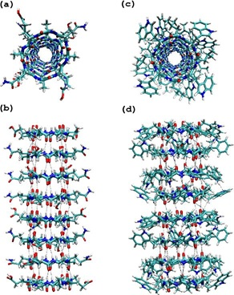
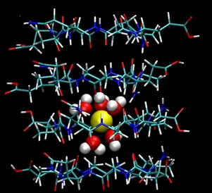

계산화학실험실(이하 '우리 실험실')에서는 **계산 및 이론 화학 방법**들을 이용하여 생체계 등 **다양한 계에서 일어나는 물리, 화학적 과정의 메커니즘** 연구를 진행하고 있습니다. 우리 실험실에서 사용하는 계산 및 이론 화학 방법들은 **통계열역학**에 기반을 두고 있으며, \*\*컴퓨터를 이용한 모의실험(computer simulation)\*\*이 주된 연구 방법의 하나입니다.

## 단백질과 기능성 분자의 세포막 결합과 투과

단백질이나 약물과 같은 기능성 분자가 세포막과 상호작용하고 이를 투과하는 메커니즘을 이해하는 것은 생명 현상을 규명하고 신약을 개발하는 데 매우 중요합니다. 예를 들어, 일부 항균 펩타이드는 박테리아의 세포막을 통과하여 세포 내부에서 항균 작용을 나타냅니다. 이러한 과정에서 펩타이드와 세포막 사이의 상호작용뿐만 아니라 세포막 내부에서 펩타이드 분자들 사이의 상호작용도 중요한 역할을 하는 것으로 알려져 있으나, 구체적인 분자 메커니즘은 아직 충분히 밝혀지지 않았습니다. 우리 실험실에서는 분자동역학 모의실험을 활용하여 단백질 및 다양한 기능성 분자의 세포막 결합과 투과 과정을 분자 수준에서 분석하고 규명하는 연구를 수행하고 있습니다.

## 고리형 펩타이드 나노튜브의 세포막 내 구조와 기능

이온채널은 세포막에 존재하는 막단백질의 한 종류로, 이온들의 세포막 통과에 관여하면서 신경과 근육의 자극, 감각신호 전달에 중요한 역할을 담당합니다. 미국 Scripps 연구소의 Ghadiri 교수 연구진이 합성한 고리형 펩타이드 나노튜브(cyclic peptide nanotube)는 이온채널과 같은 기능을 하는 합성 단백질로, 항생제나 이온센서로 사용될 수 있다고 알려져 있습니다. 고리형 펩타이드 나노튜브는 곁사슬(side chain)이 친수성인지 소수성인지에 따라 크게 두 종류로 나눌 수 있습니다.

우리 실험실에서는 분자동역학 모의실험(molecular dynamics simulation)과 몬테카를로 모의실험(Monte Carlo simulation) 등을 이용하여 고리형 펩타이드 나노튜브가 선택적으로 양이온만을 통과시키는 원인과, 나노튜브와 세포막의 상호작용이 이온 이동에 미치는 영향 등을 연구하고 있습니다.

_Hwang et al., J. Phys. Chem. B 110, 26448 (2006)_

## 

## DNA translocation

DNA translocation은 단일사슬 또는 이중사슬 DNA 분자가 세포막의 구멍(pore)이나 이온채널을 통해 세포막 한쪽에서 다른 쪽으로 이동하는 현상입니다. 이온 전류가 흐르는 이온채널에 DNA가 들어오면 전류가 감소하고, 그 감소 정도가 염기의 크기와 연관된다는 사실로부터 새로운 DNA 염기서열 분석 방법이 제안되었습니다. 우리 실험실에서는 Brownian 동역학 모의실험과 자체 개발한 kinetic lattice grand canonical Monte Carlo(KLGCMC) 모의실험을 결합하여, 세포막에 의한 반응장(reaction field)과 DNA 염기–이온 상호작용이 DNA translocation에 미치는 영향을 연구하고 있습니다.

